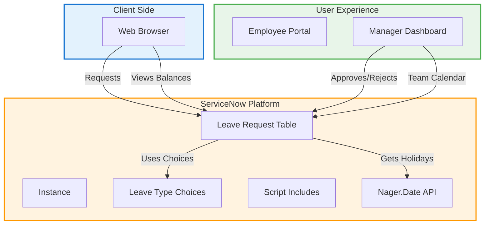

#  LeaveFlow - Leave Management Portal


> A modern leave management system for employees and managers. Submit time off, track balances, and get manager approval — all in one elegant platform.

<div align="center">

[](https://github.com/lohithjallipalli/LeaveFlow-ServiceNow)
[](https://www.servicenow.com/)

</div>

---

## 📖 What is LeaveFlow?

**LeaveFlow** is a smart leave management portal built on ServiceNow that helps teams track time off, balances, and approvals — without the hassle of endless email threads and spreadsheets.

🟢 **Employees**: Submit requests, view balances, see history  
🔵 **Managers**: Approve/reject, view team calendars, track team availability  
🟣 **Admins**: Full configuration, user management, reporting

---

## ✨ Features

### 👤 Employee
| Feature | 🎯 |
|---------|----|
| 📝 **Submit Request** | Easy form with date picker & reason |
| 💰 **Balance Tracker** | Real-time available/pent/used days |
| 📜 **History** | View past & pending requests |
| 📱 **Mobile Responsive** | Works on any device |

### 👨‍💼 Manager
| Feature | 🎯 |
|---------|----|
| ✅ **Approve/Reject** | One-click decisions with comments |
| 📅 **Team Calendar** | Visual grid of who's on leave |
| 👥 **Availability %** | Quick team overview |
| 📊 **Request Stats** | Monthly/yearly trends |

### 🛡️ Admin
| Feature | 🎯 |
|---------|----|
| 🔧 **Configure** | Set up leave types, users, roles |
| 📈 **Reporting** | Export data, generate reports |
| 👥 **User Mgmt** | Create/manage employee accounts |
| ⚙️ **System Config** | Platform settings, integrations |

---

##  Architecture 


### 📋 Data Model (What's in the Database)

| Field | Type | Description |
|-------|------|-------------|
| 🆔 **number** | String | Auto-generated record ID |
| 👤 **requested_by** | Person | Employee who submitted |
| 👔 **approved_by** | Person | Manager who approved/rejected |
| 🍃 **leave_type** | Choice | Annual • Sick • Casual • Compensatory |
| 📅 **start_date** | Date | First day of leave (inclusive) |
| 📅 **end_date** | Date | Last day of leave (inclusive) |
| 🔢 **total_days** | Integer | Auto-calculated duration |
| 📊 **status** | Choice | Draft • Submitted • Approved • Rejected |
| 💬 **reason** | Text | Why you're taking leave |

---

## 🚀 Quick Start (5 Minutes)

### 1️⃣ Clone the Repo
```bash
git clone https://github.com/lohithjallipalli/LeaveFlow-ServiceNow.git
```

### 2️⃣ Import to ServiceNow
* Go to **System Update Sets** → Select/create `LeaveFlow` update set
* **Import** the `.par` file
* Activate the `LeaveFlow` application module

### 3️⃣ Configure Leave Types
1. Navigate to **Lists → Choice**
2. Filter: **Table = `x_snc_leaveflow_leave_request`**, **Field = `leave_type`**
3. Add entries:
   - 🟢 **Annual** — 20 days allocated
   - 🟡 **Sick** — 10 days allocated  
   - 🟦 **Casual** — 5 days allocated
   - 🟪 **Compensatory** — 3 days allocated

### 4️⃣ Create Test Users
| Role | Email | 📝 |
|------|-------|----|
| 👤 Employee | test.employee@test.com | Has: employee role |
| 👨 Manager | test.manager@test.com | Has: manager + employee roles |
| 👩 HR Admin | test.hr@test.com | Has: admin + manager + employee roles |

### 5️⃣ Access the Portal
🌐 **URL**: `https://<your-instance>.service-now.com/now/leaveflow/home`  
🔑 Log in with your ServiceNow credentials

---

## 📁 Project Structure

```
LeaveFlow-ServiceNow/
│
├── 📂 updates/           # Update sets & configurations
├── 📂 scripts/           # Script Includes & Business Rules
├── 📂 images/            # Screenshots & diagrams
├── 📄 README.md          # This file
├── 📄 LICENSE           # MIT License
└── 📄 .gitignore        # Git ignore rules
```

---

## 🛠️ Tech Stack

<div align="center">

| Layer | Technology | 📝 |
|-------|------------|----|
| 🌐 **Platform** | ServiceNow (Brazil PDI) | Next Experience framework |
| 💾 **Database** | ServiceNow Relational DB | Tables, fields, choices |
| ⚙️ **Automation** | Workflow Studio, Script Includes | Approvals, calculations, integrations |
| 🌐 **External API** | Nager.Date | Public holidays (no key required) |
| 🎨 **Interface** | Responsive Web Portal | Mobile-friendly, modern design |

</div>

---

---


## 🙏 Acknowledgments

<div align="center">

[](https://www.servicenow.com/)  
[](https://github.com/)  

> *Built with ServiceNow • Inspired by modern leave management practices •

</div>

---

<div align="center">

**🍃 Happy Leave Tracking!**  
*Submit, approve, and track time off with ease.*

</div>

---

*Need help? Open an [Issue](https://github.com/lohithjallipalli/LeaveFlow-ServiceNow/issues) in the GitHub repository or reach out to the project maintainers.*

---
